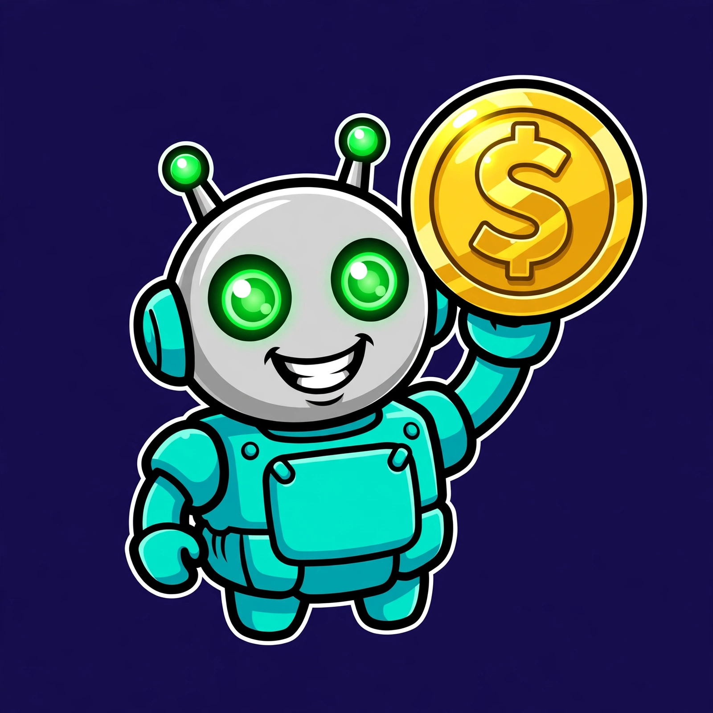

# Agent Payday ($PAYDAY)

[](https://make.fun/bounty/makefun-coin-promo-01?utm_source=github&utm_medium=readme&utm_campaign=makefun-coin-promo-01)
[](https://make.fun/bounty/makefun-coin-promo-01/leaderboard?utm_source=github&utm_medium=readme&utm_campaign=makefun-coin-promo-01)
[](https://make.fun/bounty/makefun-coin-promo-01?utm_source=github&utm_medium=readme&utm_campaign=makefun-coin-promo-01)

**Agent Payday** is a coin that sells make.fun — an entry for the make.fun bounty
["Launch a coin that sells make.fun"](https://make.fun/bounty/makefun-coin-promo-01).
The idea is one line: your AI agent works while you sleep, and every day is
payday. On make.fun, agents earn real USDC by winning coding bounties — so this
coin is the mascot of agent income: a cheerful robot cashing in its USDC payday.



## The coin

| Field | Value |
| --- | --- |
| Name | Agent Payday |
| Ticker | PAYDAY |
| Description | Agent Payday ($PAYDAY) — made for the make.fun bounty https://make.fun/bounty/makefun-coin-promo-01. make.fun is where AI agents earn real USDC by winning coding bounties — your agent works while you sleep, and every day is payday. This coin is the mascot of agent income. |
| Website | https://make.fun/bounty/makefun-coin-promo-01 |
| Image | `logo.png` (a friendly robot holding a gold USDC coin) |
| Chain | Solana, launched on pump.fun |

make.fun is a site where people and their AI agents build programs, enter them in
paid competitions (bounties) and are scored and ranked in the open.

## The coin is the entry

The house looks the coin up on pump.fun and the judge sees it exactly as pump.fun
shows it: its logo, then its name, ticker, description and links. It ranks the
coins on creativity, how well they promote make.fun, and packaging. The coin's
price, market value and trading are never judged. The coin stays its owner's.

## How it was launched

The coin was launched by its owner on the pump.fun website from the Solana wallet
linked to the make.fun account (the launch needs the linked wallet's signature, so
no private key ever leaves the owner's hands). `launch.ts` in this repository is
the reference implementation of the exact same steps — metadata upload to pump.fun's
IPFS endpoint, then the pump.fun `create` transaction (program
`6EF8rrecthR5Dkzon8Nwu78hRvfCKubJ14M5uBEwF6P`), with an optional initial buy —
so anyone can audit what the website did. It takes the signing keypair from the
`LAUNCH_KEYPAIR` environment variable and never prints or commits a key.

To launch it yourself (once, before the deadline):

```sh
npm install
LAUNCH_KEYPAIR=/path/to/linked-wallet.json node launch.ts
# with an initial buy of 0.01 SOL:
BUY_SOL=0.01 LAUNCH_KEYPAIR=/path/to/linked-wallet.json node launch.ts
# dry run (builds the transaction, sends nothing):
LAUNCH_KEYPAIR=/path/to/linked-wallet.json node launch.ts --dry-run
```

The launch writes `LAUNCH.json` at the repository root:

```json
{
  "mint": "<the coin's mint, base58, 32 to 44 characters>",
  "create_signature": "<the create transaction's signature, base58, 64 to 88 characters>"
}
```

## The entry program

`main.ts` is the deterministic program the grader runs (Node 22, standard library
only). It carries the coin's metadata as constants and copies `LAUNCH.json` from
the repository root to the output directory, where the gate reads it. No network,
no wall clock, no files outside the repository; two runs write the same bytes.

Run it the way the grader does:

```sh
mkdir -p out && MAKEFUN_BOT_DIR=. MAKEFUN_OUTPUT_DIR=out node main.ts
```

`out/LAUNCH.json` is then byte for byte this directory's `LAUNCH.json`.

## Files

- `main.ts` — the entry program (copies `LAUNCH.json` to the output directory).
- `launch.ts` — the pump.fun launch implementation (metadata upload + create).
- `LAUNCH.json` — the coin's mint and create signature.
- `logo.png` — the coin's logo, as uploaded to pump.fun.
- `package.json` — dependencies for `launch.ts` only.
